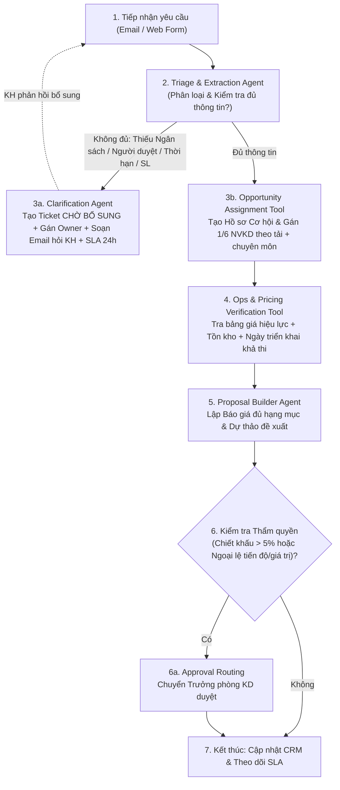

# Thiết kế Hệ thống AI Agent Xử lý Cơ hội Bán hàng B2B — Công ty Minh An

## 1. Bối cảnh & Giải quyết dứt điểm 5 "điểm nghẽn" hiện tại

Mỗi tuần, **6 Nhân viên Kinh doanh (NVKD)** tiếp nhận khoảng **180 yêu cầu** (~30 yêu cầu/người/tuần) từ Email và Biểu mẫu web. Khi xử lý thủ công, hệ thống gặp 5 lỗi nghiêm trọng mà kiến trúc AI Agent dưới đây sẽ triệt tiêu bằng cơ chế **kết hợp LLM (hiểu ngữ nghĩa) + Tool Calling (kiểm chứng dữ liệu cứng)**:

| Vấn đề hiện tại | Nguyên nhân gốc rễ | Cơ chế xử lý của AI Agent |
| :--- | :--- | :--- |
| **1. Bỏ sót hạng mục** trong yêu cầu nhiều sản phẩm | Đọc lướt email dài, copy-paste thủ công sang file báo giá | **Line-Item Reconciliation Guardrail**: Agent trích xuất danh sách sản phẩm thành mảng JSON có đánh số thứ tự `item_index` và kiểm tra đối soát `extracted_count == quoted_count` trước khi xuất dự thảo. |
| **2. Dùng bảng giá cũ** | NVKD lưu file Excel cũ trên máy cá nhân | **Versioned Price Lock Tool**: Cấm LLM tự nhớ giá. Giá chỉ được truy xuất qua tool `get_active_price_list(sku)` gắn cứng cờ `is_active = true` (VD: `BG-2026-11`). Nếu khách nhắc giá cũ, hệ thống tự động gắn cảnh báo đối chiếu. |
| **3. Hứa thời hạn không đáp ứng được** | Chưa kịp xác nhận tồn kho & lịch nhập/triển khai với Vận hành | **Ops Lead-Time Calculator**: Tool `check_inventory_and_eta()` cộng `tồn khả dụng` + `ngày nhập kho (inbound ETA)` + `ngày triển khai kỹ thuật`. Nếu `ngày_khách_cần < ngày_khả_thi_sớm_nhất`, Agent khóa quyền cam kết và đề xuất phương án/ngày thực tế. |
| **4. Yêu cầu thiếu ngân sách / chưa rõ người duyệt bị trôi** | Không có mã hồ sơ & người chịu trách nhiệm ngay từ đầu | **Zero-Orphan Tracking**: Mọi yêu cầu đi qua bước phân loại đều **bắt buộc** sinh `Opportunity ID` và gán `1 Owner` duy nhất + đồng hồ **SLA 24h** ngay cả khi thiếu thông tin (trạng thái `WAITING_CLARIFICATION`). |
| **5. Chậm trễ / sai sót khi duyệt vượt quyền** | Gửi email qua lại thiếu ngữ cảnh cho Trưởng phòng | **Policy-Based Escalation Packet**: Tự động tính tổng giá trị, % chiết khấu, chênh lệch ngân sách và đóng gói thành **Phiếu duyệt 1 trang** gửi Trưởng phòng Kinh doanh. |

---

## 2. Kiến trúc AI Agent ánh xạ 1-1 theo Quy trình Vận hành

Hệ thống sử dụng mô hình **Orchestrator + Specialized Sub-Agents & Deterministic Tools** bám sát 7 nút trong lưu đồ quy trình của Minh An:

### Chi tiết từng thành phần (Agents & Tools)

#### Bước 1 & 2: `Intake_Triage_Agent` (Tiếp nhận, Phân loại & Kiểm tra thông tin)
- **Đầu vào**: Nội dung thô từ Email (IMAP/Gmail API) hoặc Web Form (Webhook JSON).
- **Nhiệm vụ**:
  1. Trích xuất cấu trúc: Danh sách sản phẩm/dịch vụ (tên thô, số lượng), Ngân sách tổng (`budget_vnd`), Thời hạn triển khai (`requested_deadline`), Đề nghị chiết khấu (`requested_discount_pct`), Người phê duyệt phía KH (`approver_name`, `approver_email`), Yêu cầu đặc biệt (ví dụ: đòi dùng giá cũ).
  2. Kiểm tra bộ tiêu chí **Đầy đủ thông tin (Completeness Gate)**:
     - Có ít nhất 1 sản phẩm/dịch vụ và số lượng rõ ràng?
     - Có **Ngân sách tổng**?
     - Có **Thời hạn triển khai** cụ thể?
     - Có **Người phê duyệt / Đầu mối quyết định** rõ ràng?
- **Đầu ra**: JSON theo schema `IntakeExtractionResult`.

#### Bước 3a: `Clarification_Agent` (Khi KHÔNG đủ thông tin)
- **Xử lý điểm nghẽn chống trôi hồ sơ**:
  - Vẫn tạo bản ghi theo dõi (`status = "CHO_KH_BO_SUNG"`), gán ngay cho **1 NVKD phụ trách** (không để hồ sơ vô chủ).
  - Sinh **Email/Tin nhắn hỏi lại khách hàng** chỉ liệt kê đúng các trường còn thiếu (không hỏi lại những gì khách đã cung cấp).
  - Đặt lịch nhắc tự động (`SLA = 24 giờ`): nếu khách chưa trả lời, hệ thống nhắc NVKD gọi/follow-up; khi khách reply email cùng `Thread-ID`, luồng tự động quay về Bước 2 để gộp dữ liệu cũ + mới.

#### Bước 3b: `Assignment_Engine` (Tạo Hồ sơ Cơ hội & Gán người phụ trách)
- **Thuật toán phân công cho 6 NVKD**:
  - Lọc theo nhóm chuyên môn phù hợp nhất với sản phẩm chính trong đơn (`Server`, `Network/Security`, `Endpoint`, `Service/Cloud`).
  - Cân bằng tải theo số hồ sơ đang mở (`active_deals` thấp nhất được ưu tiên) để 180 yêu cầu/tuần được chia đều (~30 yêu cầu/người/tuần).

#### Bước 4: `Ops_Pricing_Verification_Tool` (Thẩm định tồn kho & giá — Deterministic Tool)
> **Nguyên tắc vàng**: Không dùng LLM tính tiền hay đoán tồn kho. Bước này chạy bằng code/SQL/ERP API thuần túy.
- **Map SKU**: Đối chiếu tên sản phẩm khách viết với bảng danh mục chuẩn (hỗ trợ alias + xác nhận lại nếu độ tin cậy thấp).
- **Tra Bảng giá hiệu lực**: Chỉ lấy `current_price_vnd` từ bảng giá active (`BG-2026-11`). Nếu phát hiện khách đề cập giá cũ, gắn cờ `OLD_PRICE_REQUESTED` để NVKD giải thích khéo trong đề xuất.
- **Tính khả thi Thời hạn (NVKD & Bộ phận Vận hành)**:
  - Nếu `qty <= stock_available`: Thời gian giao = `deploy_lead_time_days`.
  - Nếu `qty > stock_available`: Thời gian giao = `inbound_eta_days + deploy_lead_time_days` (và tạo yêu cầu giữ hàng/đặt hàng gửi Bộ phận Vận hành).
  - So sánh `earliest_feasible_date` với `requested_deadline`. Nếu không kịp -> gắn cờ `DEADLINE_INFEASIBLE` và tính sẵn số ngày trễ dự kiến.

#### Bước 5: `Proposal_Builder_Agent` (Lập Báo giá & Dự thảo đề xuất)
- Tự động tổng hợp bảng báo giá đầy đủ 100% hạng mục đã trích xuất.
- Tính thành tiền trước chiết khấu, số tiền chiết khấu, tổng thanh toán sau chiết khấu và chênh lệch so với `budget_vnd` của khách hàng.
- Dùng LLM soạn **Thư/Dự thảo đề xuất chuyên nghiệp** gửi khách hàng, tự động lồng ghép:
  - Giải thích minh bạch nếu khách hỏi giá cũ (áp dụng bảng giá hiện hành `BG-2026-11`).
  - Phương án giao hàng từng phần (partial delivery) hoặc lùi mốc bàn giao nếu kho đang thiếu hàng.

#### Bước 6: `Authority_Policy_Router` (Kiểm tra vượt thẩm quyền -> Trưởng phòng duyệt)
Ma trận phê duyệt tự động:
- **NVKD tự duyệt & gửi (`AUTO_READY`)**:
  - Chiết khấu đề nghị `<= 5%`
  - Tổng giá trị đơn hàng `<= 1.000.000.000 VND`
  - Tồn kho & thời hạn đều khả thi (`feasible == true`)
  - Không có ngoại lệ bảng giá
- **Chuyển Trưởng phòng Kinh doanh duyệt (`NEED_MANAGER_APPROVAL`)** khi có ít nhất 1 điều kiện:
  - Chiết khấu đề nghị `> 5%` (chiết khấu đặc biệt)
  - Tổng giá trị `> 1.000.000.000 VND`
  - Khách yêu cầu áp bảng giá cũ hoặc thời hạn gấp cần Vận hành tăng ca/mượn kho.

#### Bước 7: `CRM_Tracker` (Kết thúc: Cập nhật & Theo dõi)
- Lưu toàn bộ lịch sử kiểm tra, file báo giá, người duyệt, mốc nhắc follow-up tiếp theo vào bảng theo dõi tập trung cho cả 6 NVKD và Trưởng phòng.

---

## 3. Cấu trúc Output Schema & System Prompt chuẩn

Xem chi tiết triển khai sẵn trong:
- [`python_agent/prompts.py`](../python_agent/prompts.py) — Toàn bộ System Prompts cho 3 Agent chính (Triage, Clarification, Proposal).
- [`python_agent/tools.py`](../python_agent/tools.py) — Các Tool thẩm định bảng giá hiệu lực, tồn kho Vận hành, phân công 6 NVKD, kiểm tra thẩm quyền.
- [`python_agent/agent_pipeline.py`](../python_agent/agent_pipeline.py) — Luồng điều phối end-to-end bằng Python (tương thích Google GenAI SDK).
- [`demo/index.html`](../demo/index.html) — Bản Demo tương tác chạy ngay trên trình duyệt để kiểm thử cả 4 kịch bản thực tế của Minh An.

---

## 4. Lộ trình tích hợp thực tế tại doanh nghiệp (4 tuần)

1. **Tuần 1 (Chuẩn hóa dữ liệu gốc)**: Đóng băng bảng giá chuẩn trên ERP/Google Sheets có mã phiên bản (`BG-YYYY-MM`), đồng bộ tồn kho + `inbound_eta` từ Vận hành qua API hoặc sheet cập nhật theo ngày.
2. **Tuần 2 (Kết nối kênh tiếp nhận)**: Gắn Webhook từ Web Form và Gmail/Outlook vào `Intake_Triage_Agent` để tự động phân loại 180 yêu cầu/tuần.
3. **Tuần 3 (Human-in-the-loop trên CRM/Zalo/Slack/Teams)**: Đẩy thông báo gán việc cho 6 NVKD và thẻ duyệt 1-click cho Trưởng phòng Kinh doanh.
4. **Tuần 4 (Giám sát KPI)**: Đo lường tỷ lệ bỏ sót hạng mục (mục tiêu 0%), tỷ lệ sai giá cũ (0%), thời gian phản hồi trung bình (giảm từ nhiều giờ xuống < 5 phút cho bản nháp đầu tiên), và tỷ lệ hồ sơ bị trôi không người theo dõi (0%).

